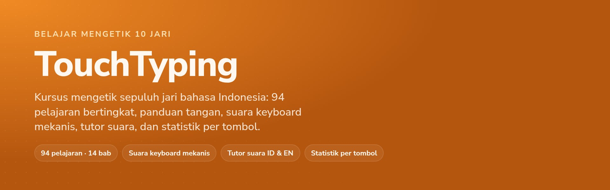
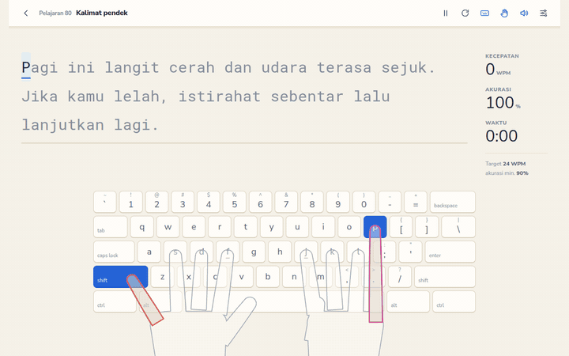
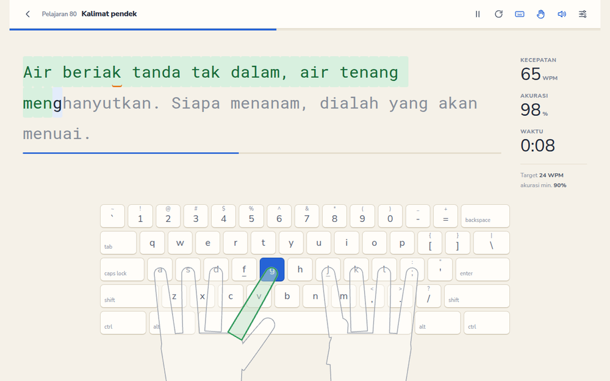
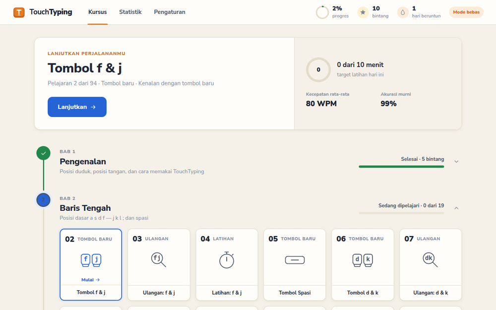
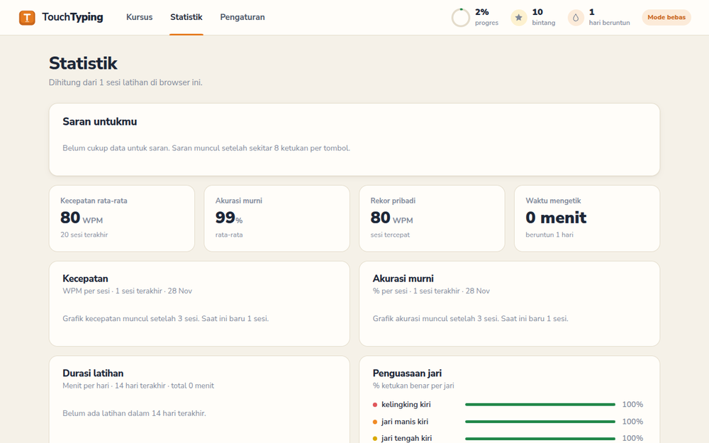
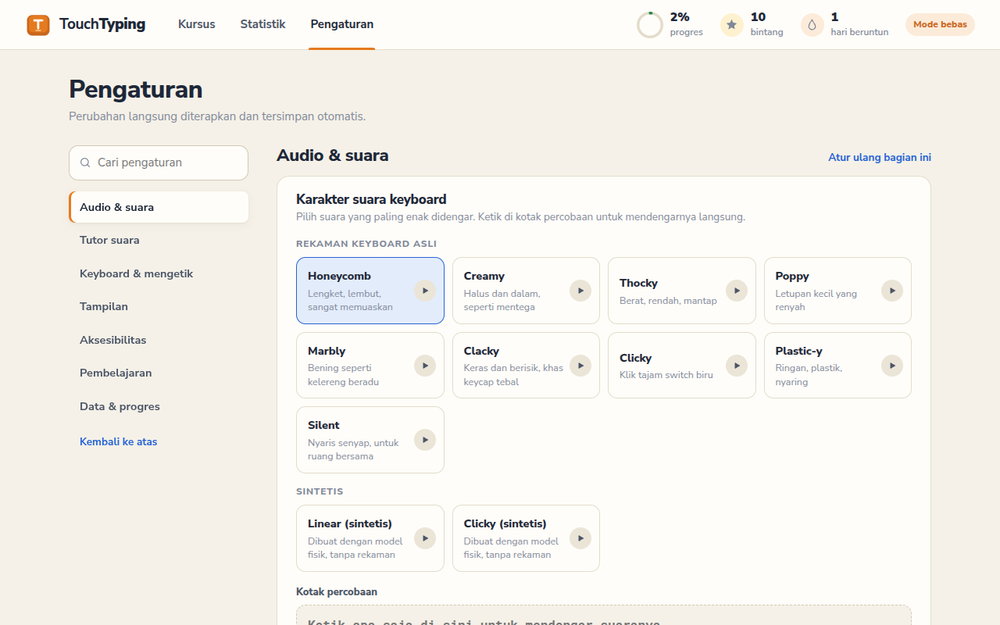

<p align="center">
  
</p>

<p align="center">
  <a href="https://touchtyping.xianzing.my.id"></a>
</p>

<p align="center">
  
  
  
  
  
  
</p>

**TouchTyping** adalah web app belajar mengetik sepuluh jari dalam bahasa Indonesia. Kurikulum bertingkat dari mengenal baris tengah sampai paragraf panjang, lengkap dengan panduan tangan, suara keyboard mekanis, tutor suara, dan statistik yang memberi saran latihan. Situs statis murni (tanpa bundler), di-deploy ke Cloudflare Workers.

## Sekilas

<p align="center">
  
</p>

<table>
  <tr>
    <td align="center"><br><sub>Teks berubah warna + tombol & jari tujuan menyala</sub></td>
    <td align="center"><br><sub>94 pelajaran dalam 14 bab, terbuka berurutan</sub></td>
  </tr>
  <tr>
    <td align="center"><br><sub>WPM, akurasi, tombol & jari terlemah, tren</sub></td>
    <td align="center"><br><sub>11 profil suara keyboard + mixer volume</sub></td>
  </tr>
</table>

## Fitur utama

- **94 pelajaran dalam 14 bab**: pengenalan, baris tengah/atas/bawah, angka, huruf besar & simbol, kata, kalimat, paragraf, kecepatan, akurasi, dan ujian akhir. Pelajaran terbuka berurutan (minimal 1 bintang), atau semua sekaligus lewat **mode bebas**.
- **Engine ketik per karakter**: status belum/aktif/benar/salah/dikoreksi; WPM, akurasi, dan **akurasi murni** (kesalahan yang dikoreksi tetap dihitung).
- **Keyboard virtual + tangan SVG**: jari yang tepat bergerak ke tombol tujuan, termasuk shift dari tangan seberang.
- **Suara keyboard dari sampel**: 9 profil hasil potongan rekaman keyboard asli dan 2 profil sintetis, plus mixer volume (utama × keyboard / umpan balik / tutor).
- **Tutor suara**: klip yang dibuat sekali (tanpa panggilan API saat mengetik, tanpa kunci API di browser), dalam bahasa Indonesia dan Inggris.
- **Statistik yang memberi saran**: tombol dan jari terlemah, pola kesalahan antar-huruf, tren, rekomendasi pelajaran, serta **Latihan Pintar** per tombol.
- **Pengaturan lengkap**: pencarian, atur ulang per bagian, kontras tinggi, kurangi animasi, mode satu tangan, dan cadangan/pulihkan progres (localStorage, dengan migrasi versi).

## Cara pakai

**Langsung di browser:** buka <https://touchtyping.xianzing.my.id>. Latihan posisi jari paling baik dengan keyboard fisik (di HP ada mode "tetap coba", tapi keyboard layar tidak bisa mengajarkan posisi jari).

**Menjalankan sendiri:**

```bash
python3 -m http.server 8765 -d public   # buka http://localhost:8765
node tests/engine.test.cjs              # tes engine & filter input (murni, tanpa browser)
npx cf deploy                           # deploy ke Cloudflare
```

## Struktur

```
public/            situs statis (di-deploy ke Cloudflare Workers static assets)
  js/engine.js     engine ketik + filter input (murni, diuji)
  js/audio.js      audio engine: sprite sampel, bus volume, tutor suara
  js/keyboard.js   keyboard virtual + tangan
  js/course.js     kurikulum + generator teks
  js/store.js      progres & pengaturan (localStorage, migrasi versi)
  js/ui.js, app.js tampilan + router
  sfx/             sprite suara (.wav + offset .json)
  voice/<pack>/    klip tutor suara + manifest; voice/packs.json = daftar paket
tools/
  make_sfx.py      render suara sintetis
  slice_samples.py potong rekaman keyboard menjadi sprite per ketukan
  gen_voice.py     buat paket tutor suara lewat API (ElevenLabs "Putra" atau OmniVoice)
  align_pack.py    potong satu rekaman panjang menjadi klip per baris (faster-whisper)
tests/engine.test.cjs
```

## Tutor suara ElevenLabs (Putra)

Paket `putra-id` dan `putra-en` dibuat dengan satu generate per bahasa di web app ElevenLabs (suara "Putra", model Multilingual v2; teks dari `tools/voice_lines*.json`, satu baris per paragraf). Rekaman panjang itu lalu dipotong per baris dengan pengenalan suara:

```bash
pip install faster-whisper
python3 tools/align_pack.py rekaman-id.mp3 --lang id --pack putra-id --label "Putra (ElevenLabs)"
python3 tools/align_pack.py rekaman-en.mp3 --lang en --pack putra-en --label "Putra (ElevenLabs)"
# baris berurutan yang salah potong bisa dipotong ulang berdasarkan jeda: --fix key_r,key_t,key_y
```

Alternatif lewat API (butuh kredit di akun API key): `python3 tools/gen_voice.py elevenlabs --lang id --pack putra-id --label "Putra (ElevenLabs)"`. Paket baru otomatis muncul di Pengaturan › Tutor suara dan dipakai pada mode "Otomatis".

## Sumber suara

Profil rekaman dipotong dari video YouTube "ASMR Typing on a Honeycomb Keyboard" (Shifwithme101) dan "Keyboard sounds comparison" (LumeKeebs). Hak cipta rekaman ada pada pemiliknya. Minta izin atau ganti sampelnya sebelum dipakai secara komersial.

---

<p align="center"><sub>Dibuat oleh <a href="https://github.com/ky-Mind">ky-Mind</a> · <a href="https://kymind.web.id">kymind.web.id</a></sub></p>
